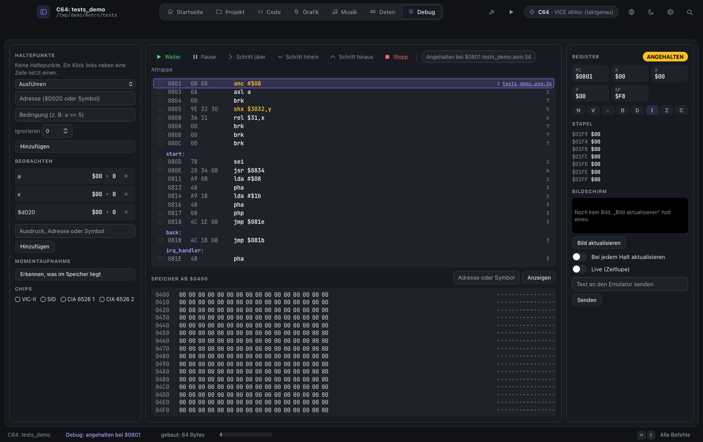

# VintageCoder

[Deutsch](README.md) | English

Development environment for retro computers with a 6502 processor: write programs in assembler or BASIC, build them, run and debug them in an emulator or on real hardware. It also includes editors for sprites, character sets, screens, palettes and music.

> **Note.** VintageCoder is under development and certainly still contains bugs. Back up your work regularly. There is no warranty, including for data loss (see [License](#license)).



## Supported systems

| System | Languages | Emulator / hardware |
|---|---|---|
| Commodore 64 | Assembler, BASIC V2 | VICE, Ultimate 64 / II+ |
| Commodore 128 | Assembler, BASIC 7.0 | VICE |
| Commodore 16 / Plus/4 | Assembler, BASIC 3.5 | VICE |
| Commodore VIC-20 | Assembler, BASIC V2 | VICE |
| Commodore PET | Assembler, BASIC | VICE |
| Atari 8 bit (800, XL, XE) | Assembler, Atari BASIC, Turbo BASIC XL | atari800, Altirra (Windows) |
| MEGA65 | Assembler (45GS02), BASIC 65 | Xemu, MEGA65 hardware |

**The packages of the next release contain C64, Plus/4 (and C16), Commodore 128, VIC-20, Atari 8 bit and MEGA65.** PET (spike state: only data, templates and BASIC examples so far) is in the source code, but it is deselected in the release selection ([FEATURES.md](FEATURES.md)) and hidden in the packages. Connecting real MEGA65 hardware is deselected as well (the device has not been tested yet). In a build from source everything is visible (there is no `data/release.json`); the selection is described in [docs/release-auswahl.md](docs/release-auswahl.md) (German). How far each function has been tested is in [STATUS.md](STATUS.md). The hardware descriptions (processors, chips, memory maps) are JSON files in `data/`. You can add new systems with them without changing the programs.

## What VintageCoder can do

- **Editor** with syntax colors, completion, code folding, live errors and help for the word at the cursor.
- **Assembler** with macros, scopes, conditional assembly, cycle counting and cycle budgets, segments and banks. Output as PRG, BIN, XEX and cartridges (CRT, CAR).
- **BASIC in the original dialect** of the target system, optionally without line numbers (with jump labels and long variable names) and with conversion to assembler.
- **Debugger** with breakpoints (also conditional), data breakpoints, registers, memory, disassembler and memory map.
- **Automatic tests** for assembler projects: static checks and subroutine tests in the emulator.
- **Graphics and music editors:** sprites (also Atari PMG), character sets, text screens, tile maps, palettes, tracker for SID and POKEY, PLAY tracker for the MEGA65. Export as assembler, constants, binary file, PRG or BASIC DATA.
- **Disk editor** for D64, D71, D81 and ATR, including bootable Atari disks.
- **Command line `vcc`** for building, tests, disk images and media, suitable for scripts and CI.
- **Language server** (`vc-lsp`) for other editors ([guide](docs/sprachserver.md), German).
- **Project wizard** with templates and guided first-time setup.

An illustrated guide is in the [manual](docs/handbuch/en/kapitel/) (also in the application under *Help*). The feature overview is in [FEATURES.md](FEATURES.md), the development status in [STATUS.md](STATUS.md), the changes in the [CHANGELOG](CHANGELOG.md) (German). If you want to look into the source code, start at [docs/architektur.md](docs/architektur.md) (German).

## Installation

### Ready-made packages

The packages for version 0.3.0 are available under [GitHub > Releases](https://github.com/CDrueeke/VintageCoder/releases) (tag `v0.3.0`) and on the [project website](https://vintagecoder.drueeke.de/). Each release includes a file `SHA256SUMS` for checking the downloads.

| System | Package | Requirement |
|---|---|---|
| macOS | `.dmg` | Apple chip (arm64) |
| Windows | `Setup.exe` | 64 bit (x86_64); tested on Windows 11 |
| Debian, Ubuntu | two `.deb` (command line and user interface) | Debian 13 or newer, Ubuntu 24.04 or newer, x86_64 |
| Fedora, openSUSE | two `.rpm` | Fedora 45 or newer, openSUSE Tumbleweed, x86_64 |
| other Linux systems | `.tar.gz` | x86_64, glibc 2.39 or newer |

**Not supported:** Intel Macs and ARM computers under Windows and Linux. There are no packages for them; a build from source is untested there.

> **The packages are not signed.** Windows and macOS therefore warn you on first start:
> - **macOS:** in the "Applications" folder, right-click VintageCoder, choose **Open**, and click **Open** again in the dialog (newer macOS versions: *System Settings > Privacy & Security > Open Anyway*).
> - **Windows (SmartScreen):** **More info > Run anyway**.
> - **Linux:** the `.deb` and `.rpm` packages are not signed either; `zypper` asks or needs `--allow-unsigned-rpm`.
>
> Check downloads with `SHA256SUMS` and download only from the official release or from the website. Further steps and the installation for each system are in the manual, chapter [Installation and first-time setup](docs/handbuch/en/kapitel/00-installation.md). State of testing: the Linux packages were tested in fresh containers and on an Ubuntu 24.04 test machine with a desktop (sound and Wayland not tested); the Windows setup is tested on Windows 11; the macOS package is only partly tested (see [STATUS.md](STATUS.md)).

### Build from source

You need the [Rust](https://rustup.rs) toolchain in version **1.95 or newer** (the highest minimum version of the dependencies according to `cargo metadata`; builds and tests use the current stable version) and `git`.

```bash
git clone https://github.com/CDrueeke/VintageCoder.git
cd VintageCoder
cargo build --release
cargo run --release -p vc-gui -- examples/c64/border     # user interface with an example project (the file is called `target/release/vintagecoder`)
./target/release/vcc asm examples/c64/border/border.asm -o border.prg   # command line
```

- **macOS:** the Apple command line tools (the terminal offers to install them the first time you run `git` or `cc`), nothing else special.
- **Windows:** Rust with the MSVC toolchain (the Microsoft Build Tools with the workload "Desktop development with C++"). On Windows the programs are called `vintagecoder.exe` and `vcc.exe` in `target\release\`.
- **Linux (Debian, Ubuntu, Fedora, openSUSE; X11 and Wayland):** additionally a C compiler, `pkg-config` and some development libraries (ALSA, xkbcommon, Wayland, X11, OpenGL/EGL); the package names for each distribution are in the [Linux help](crates/vc-ide/help/en/linux.md).

The installation packages themselves are put together with `python3 tools/release.py` (see [docs/release-auswahl.md](docs/release-auswahl.md), German); end users do not need this.

### Emulators and ROMs

To run and debug programs you need an emulator, which you enter under *Settings > Target systems*: [VICE](https://vice-emu.sourceforge.io) (for the debugger on Windows from version 3.10), [atari800](https://atari800.github.io), [Altirra](https://www.virtualdub.org/altirra.html) or [Xemu](https://github.com/lgblgblgb/xemu). The packages do not contain emulators.

**ROMs:** VintageCoder does not include original ROMs and does not download any. If you need them (for example for emulators or original character sets), put your own images in the ROM folder; an assistant helps with this.

## Command line and language server

`vcc` offers building, tests, disk images and media for scripts and CI; all commands are listed in [docs/cli.en.md](docs/cli.en.md). The language server `vc-lsp` provides editor functions (errors, completion, hover, go to definition) through the Language Server Protocol; how to connect it to other editors: [docs/sprachserver.md](docs/sprachserver.md) (German).

## Contributing and reporting bugs

Bugs and wishes are welcome as an [issue](https://github.com/CDrueeke/VintageCoder/issues) or by e-mail to <vintagecoder@drueeke.de>; in the application, *Help > Send feedback ...* (or `vcc feedback`) prepares an e-mail with version and system details, and only you send it. Pull requests are welcome but not guaranteed to be accepted: see [CONTRIBUTING.md](CONTRIBUTING.md). Please do not report security vulnerabilities in public: [SECURITY.md](SECURITY.md).

The earlier development history is not part of this repository; it contains release states.

## Examples

In [`examples/`](examples/) (English comments and texts in [`examples/en/`](examples/en/)) there are runnable projects for all systems, such as raster bars, sprites, music, cartridges and BASIC programs. Each one is its own folder with a `.vcprj` and can be opened directly.

## Origin

VintageCoder is developed with strong AI support: the source code is largely written by an AI; concept, decisions, tests and approvals are the responsibility of the project owner.

## License

VintageCoder is licensed under the **GNU General Public License, version 3 or later** ([LICENSE](LICENSE)), without warranty. What you may do with VintageCoder, with the VCASM language and with the generated files is described in [LICENSING.md](LICENSING.md). System files (`data/sys/`), templates (`data/templates/`) and example projects (`examples/`) are under the **MIT No Attribution license (MIT-0)** ([LICENSES/MIT-0.txt](LICENSES/MIT-0.txt)). The logo (`branding/`) and the name "VintageCoder" are excluded from the GPL (details in [LICENSING.md](LICENSING.md)).

## Acknowledgements

VintageCoder contains parts of other projects, among them:

- **Raster Music Tracker (RMT player)** in the Atari examples: Radek Sterba / Raster / C.P.U. 2002-2009, continued by Vin Samuel and Peter Dell, GPL v3, [source](https://github.com/raster-atari-org/RASTER-Music-Tracker).
- **JetBrains Mono** ([font](https://github.com/JetBrains/JetBrainsMono)), **CodeMirror** ([editor](https://codemirror.net)), **Project Fluent** ([texts](https://projectfluent.org)), **Tauri** ([application framework](https://tauri.app)) and the Rust libraries.
- The emulators that VintageCoder starts and that the user installs themselves: [VICE](https://vice-emu.sourceforge.io), [atari800](https://atari800.github.io), [Altirra](https://www.virtualdub.org/altirra.html), [Fujisan](https://github.com/pedgarcia/fujisan) and [Xemu](https://github.com/lgblgblgb/xemu); also **MEGA65 core** as a source of technical data.

The full list with authors and licenses is in [THIRD-PARTY-NOTICES.md](THIRD-PARTY-NOTICES.md).

Website: <https://vintagecoder.drueeke.de>
