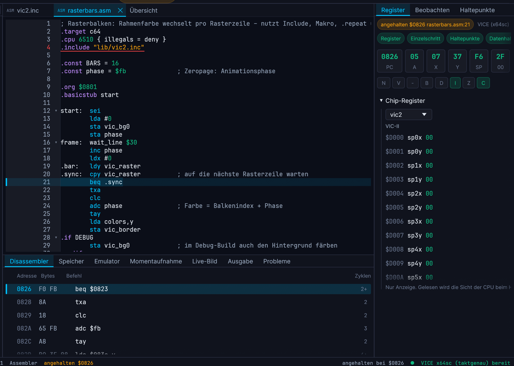

# VintageCoder

Entwicklungsumgebung für Retro-Rechner mit 6502-Prozessor: Programme in Assembler oder BASIC schreiben, bauen, im Emulator oder auf echter Hardware starten und debuggen – dazu Editoren für Sprites, Zeichensätze, Bildschirme, Paletten und Musik.

> **Alpha-Stadium.** VintageCoder ist in Entwicklung und enthält mit Sicherheit noch Fehler. Sichere deine Arbeit regelmäßig. Es gibt keine Gewähr, auch nicht für Datenverlust (siehe [Lizenz](#lizenz)).



## Unterstützte Systeme

| System | Sprachen | Emulator / Hardware |
|---|---|---|
| Commodore 64 | Assembler, BASIC V2 | VICE, Ultimate 64 / II+ |
| Commodore 128 | Assembler, BASIC 7.0 | VICE |
| Commodore 16 / Plus/4 | Assembler, BASIC 3.5 | VICE |
| Commodore VC-20 | Assembler, BASIC V2 | VICE |
| Commodore PET, CBM-II | Assembler (PET), BASIC | VICE |
| Atari 8-Bit (800, XL, XE) | Assembler, Atari BASIC, Turbo BASIC XL | atari800, Altirra (Windows) |
| MEGA65 | Assembler (45GS02), BASIC 65 | Xemu, MEGA65-Hardware |

**In den Paketen der Version 0.1.0 sind C64, Plus/4 (und C16), Atari 8 Bit und MEGA65 enthalten.** Commodore 128 und VC-20 (Stand Beta) sowie PET und CBM-II (Stand Spike: erst Daten, Vorlagen und BASIC-Beispiele) sind im Quelltext vorhanden, aber in der Release-Auswahl ([FEATURES.md](FEATURES.md)) abgewählt und in den Paketen ausgeblendet. Der Anschluss echter MEGA65-Hardware ist ebenfalls abgewählt (Gerät bisher nicht geprüft). In einem Bau aus dem Quelltext ist alles sichtbar (es gibt keine `data/release.json`); die Auswahl steht in [docs/release-auswahl.md](docs/release-auswahl.md). Wie weit die Funktionen geprüft sind, steht in [STATUS.md](STATUS.md). Die Hardware-Beschreibungen (Prozessoren, Chips, Speicherkarten) liegen als JSON-Dateien in `data/`. Neue Systeme lassen sich damit ergänzen, ohne die Programme zu ändern.

## Was VintageCoder kann

- **Editor** mit Syntaxfarben, Vervollständigung, Code-Faltung, Live-Fehlern und Hilfe zum Wort am Cursor (F1).
- **Assembler** mit Makros, Scopes, bedingter Übersetzung, Zyklenzählung und Zyklenbudgets, Segmenten und Bänken. Ausgabe als PRG, BIN, XEX sowie Steckmodule (CRT, CAR).
- **BASIC im Originaldialekt** des Zielsystems, auf Wunsch ohne Zeilennummern (mit Sprungmarken und langen Variablennamen) und mit Umwandlung nach Assembler.
- **Debugger** mit Haltepunkten (auch bedingt), Datenhaltepunkten, Registern, Speicher, Disassembler und Memory Map.
- **Automatische Tests** für Assembler-Projekte: statische Prüfungen und Unterprogramm-Tests im Emulator.
- **Grafik- und Musik-Editoren:** Sprites (auch Atari-PMG), Zeichensätze, Textbildschirme, Kachelkarten, Paletten, Tracker für SID und POKEY, PLAY-Tracker für den MEGA65. Export als Assembler, Konstanten, Binärdatei, PRG oder BASIC-DATA.
- **Disk-Studio** für D64, D71, D81 und ATR, auch bootbare Atari-Disketten.
- **Kommandozeile `vcc`** für Bauen, Tests, Disk-Images und Medien, geeignet für Skripte und CI.
- **Language Server** (`vc-lsp`) für andere Editoren ([Anleitung](docs/sprachserver.md)).
- **Projektassistent** mit Vorlagen und geführter Ersteinrichtung.

Eine bebilderte Anleitung steht im [Handbuch](docs/handbuch/kapitel/) (auch in der Anwendung unter *Hilfe*). Die Funktionsübersicht steht in [FEATURES.md](FEATURES.md), der Entwicklungsstand in [STATUS.md](STATUS.md), die Änderungen im [CHANGELOG](CHANGELOG.md).

## Installation

### Fertige Pakete

Die Pakete für Version 0.1.0 (Alpha) gibt es unter [GitHub ▸ Releases](https://github.com/CDrueeke/VintageCoder/releases) (Tag `v0.1.0`, als Vorabversion gekennzeichnet) und auf der [Webseite des Projekts](https://vintagecoder.drueeke.de/). Zu jedem Release gehört eine Datei `SHA256SUMS` zum Prüfen der Downloads.

| System | Paket | Voraussetzung |
|---|---|---|
| macOS | `.dmg` | Apple-Chip (arm64) |
| Windows | `Setup.exe` | 64 Bit (x86_64); getestet unter Windows 11 |
| Debian, Ubuntu | zwei `.deb` (Kommandozeile und Oberfläche) | Debian 13 oder neuer, Ubuntu 24.04 oder neuer, x86_64 |
| Fedora, openSUSE | zwei `.rpm` | Fedora 45 oder neuer, openSUSE Tumbleweed, x86_64 |
| andere Linux-Systeme | `.tar.gz` | x86_64, glibc 2.39 oder neuer |

**Nicht unterstützt:** Intel-Macs sowie ARM-Rechner unter Windows und Linux. Dafür gibt es keine Pakete; ein Bau aus dem Quelltext ist dort ungeprüft.

> **Die Pakete sind nicht signiert.** Windows und macOS warnen deshalb beim ersten Start:
> - **macOS:** im Ordner „Programme“ mit der rechten Maustaste auf VintageCoder klicken, **Öffnen** wählen und im Dialog noch einmal **Öffnen** (neuere macOS-Versionen: *Systemeinstellungen ▸ Datenschutz & Sicherheit ▸ Trotzdem öffnen*).
> - **Windows (SmartScreen):** **Weitere Informationen ▸ Trotzdem ausführen**.
> - **Linux:** die `.deb`- und `.rpm`-Pakete sind ebenfalls nicht signiert; `zypper` fragt oder braucht `--allow-unsigned-rpm`.
>
> Prüfe Downloads mit `SHA256SUMS` und lade nur aus dem offiziellen Release oder von der Website. Weitere Schritte und die Installation je System stehen im Handbuch, Kapitel [Installation und Ersteinrichtung](docs/handbuch/kapitel/00-installation.md). Der Stand der Prüfung: Die Linux-Pakete wurden in frischen Containern installiert und getestet, die Oberfläche dabei nur mit Software-Darstellung; Windows-Installer und macOS-Paket sind nur teilweise geprüft (siehe [STATUS.md](STATUS.md)).

### Aus dem Quelltext bauen

Nötig sind die [Rust](https://rustup.rs)-Toolchain, und zwar in Version **1.95 oder neuer** (die höchste Mindestversion der Abhängigkeiten laut `cargo metadata`; gebaut und getestet wird mit der jeweils aktuellen stabilen Version), sowie `git`.

```bash
git clone https://github.com/CDrueeke/VintageCoder.git
cd VintageCoder
cargo build --release
cargo run --release -p vc-app -- examples/c64/border     # Oberfläche mit einem Beispielprojekt
./target/release/vcc asm examples/c64/border/border.asm -o border.prg   # Kommandozeile
```

- **macOS:** die Kommandozeilenwerkzeuge von Apple (das Terminal bietet sie beim ersten Aufruf von `git` oder `cc` zur Installation an), sonst nichts Besonderes.
- **Windows:** Rust mit der MSVC-Toolchain (die Build-Tools von Microsoft mit der Arbeitslast „Desktopentwicklung mit C++“). Unter Windows heißen die Programme `vintagecoder.exe` und `vcc.exe` in `target\release\`.
- **Linux (Debian, Ubuntu, Fedora, openSUSE; X11 und Wayland):** zusätzlich ein C-Compiler, `pkg-config` und einige Entwicklungsbibliotheken (ALSA, xkbcommon, Wayland, X11, OpenGL/EGL); die Paketnamen je Distribution stehen in der [Linux-Hilfe](crates/vc-ide/help/linux.md).

Die Installationspakete selbst werden mit `python3 tools/release.py` zusammengestellt (siehe [docs/release-auswahl.md](docs/release-auswahl.md)); für Endanwender ist das nicht nötig.

### Emulatoren und ROMs

Zum Starten und Debuggen braucht man einen Emulator, der unter *Einstellungen ▸ Zielsysteme* eingetragen wird: [VICE](https://vice-emu.sourceforge.io) (für den Debugger unter Windows ab Version 3.10), [atari800](https://atari800.github.io), [Altirra](https://www.virtualdub.org/altirra.html) oder [Xemu](https://github.com/lgblgblgb/xemu). Die Pakete enthalten keine Emulatoren.

**ROMs:** VintageCoder liefert keine Original-ROMs mit und lädt keine herunter. Wer sie braucht (zum Beispiel für Emulatoren oder Original-Zeichensätze), legt eigene Abbilder in den ROM-Ordner, ein Assistent hilft dabei. Ob ein Abbild benutzt werden darf, klärt jeder selbst.

## Kommandozeile und Sprachserver

`vcc` bietet Bauen, Tests, Disk-Images und Medien für Skripte und CI; alle Befehle stehen in [docs/cli.md](docs/cli.md). Der Sprachserver `vc-lsp` liefert Editor-Funktionen (Fehler, Vervollständigung, Hover, Gehe zu Definition) über das Language Server Protocol; Einbinden in andere Editoren: [docs/sprachserver.md](docs/sprachserver.md).

## Mitwirken und Fehler melden

Fehler und Wünsche gern als [Issue](https://github.com/CDrueeke/VintageCoder/issues) oder per E-Mail an <vintagecoder@drueeke.de>; in der Anwendung bereitet *Hilfe ▸ Feedback senden …* (oder `vcc feedback`) eine Mail mit Version und Systemangaben vor, abgeschickt wird sie nur von dir. Pull Requests sind willkommen, aber nicht garantiert angenommen: siehe [CONTRIBUTING.md](CONTRIBUTING.md). Sicherheitslücken bitte nicht öffentlich melden: [SECURITY.md](SECURITY.md).

Die frühere Entwicklungsgeschichte ist nicht Teil dieses Repositorys; es enthält Releasestände.

## Beispiele

Unter [`examples/`](examples/) liegen lauffähige Projekte für alle Systeme, etwa Rasterbalken, Sprites, Musik, Steckmodule und BASIC-Programme. Jedes ist ein eigener Ordner mit `.vcprj` und lässt sich direkt öffnen.

## Lizenz

VintageCoder steht unter der **GNU General Public License, Version 3 oder später** ([LICENSE](LICENSE)). Die Software wird ohne jede Gewährleistung bereitgestellt, insbesondere ohne Haftung für Datenverlust oder Schäden an Daten und Hardware. Herkunft und Lizenzen enthaltener Fremdinhalte: [THIRD-PARTY-NOTICES.md](THIRD-PARTY-NOTICES.md).

**Ausgenommen von der GPL** sind das Logo (`crates/vc-app/assets/drueeke-logo-light.png`) und der Name „VintageCoder“: Ihre Verwendung ist nicht frei.

Die Beispielprojekte unter `examples/` sind eigene Werke des Projekts; Fremdanteile (zum Beispiel der RMT-Player) sind in [THIRD-PARTY-NOTICES.md](THIRD-PARTY-NOTICES.md) genannt.

Website: <https://vintagecoder.drueeke.de>
